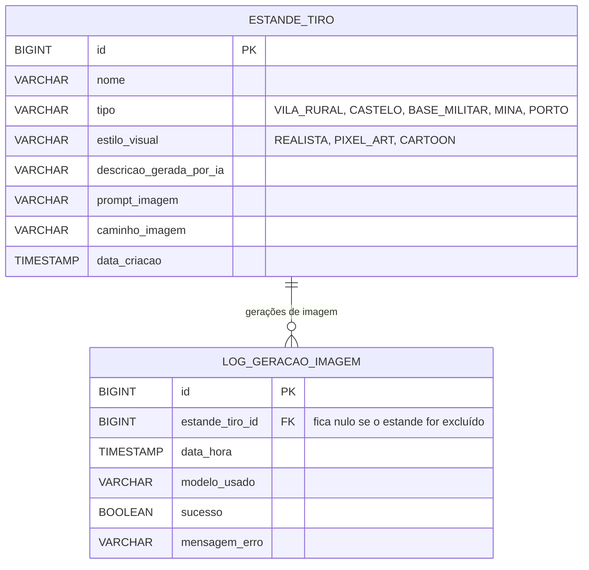

# Estande Sombrio — cenários de estande de tiro com IA

Sistema web da **Atividade GenAI**, feito com **Spring Boot 3 + Spring AI**. Ele cadastra os estandes de tiro de
minigames inspirados no estande de tiro do Mercador (*Resident Evil 4*) e usa IA generativa (**Google Gemini**) para
criar a **descrição**, o **prompt de imagem** e a **imagem de fundo** de cada estande.

Cada minigame tem uma **imagem de fundo fixa** (o cenário do estande). A parte dinâmica são os **alvos**, que aparecem
e somem por cima dela. A tela do estande tem uma prévia disso: o botão *Testar alvos* faz alvos de madeira surgirem
na área central do cenário.

## Requisitos da atividade × onde estão

| Requisito | Onde |
|---|---|
| Integração com banco de dados | Spring Data JPA + H2 em arquivo (`./data/estandes.mv.db`), tabelas `estande_tiro` e `log_geracao_imagem` |
| Interface web | Thymeleaf + CSS (`src/main/resources/templates`, `static/css/estilo.css`) |
| Integração com GenAI via Spring AI | `ChatClient` do Spring AI com o starter `spring-ai-starter-model-google-genai` (`config/GenAiConfig.java`) |
| Funcionalidades que usam GenAI | Gerar descrição e gerar prompt de imagem (texto); gerar cenário (imagem) |
| Chave da API fora do GitHub | As chaves ficam só no `.env`, que está no `.gitignore`. O `application.properties` só referencia variáveis |

## Tecnologias

- **Java 21**, **Spring Boot 3.5.16**, Maven (com Maven Wrapper: não precisa instalar o Maven)
- **Spring AI 1.1.8**, a versão estável mais recente compatível com Spring Boot 3 (a linha 2.x do Spring AI exige
  Spring Boot 4), com o starter **`spring-ai-starter-model-google-genai`**
- Spring Data JPA + **H2 em modo arquivo**
- Thymeleaf + CSS + um pouco de JavaScript

## Como rodar

**1. Pré-requisito:** JDK 21 instalado (com `JAVA_HOME` configurado).

**2. Crie o arquivo `.env`** na raiz do projeto, a partir do modelo `.env.example`:

```powershell
Copy-Item .env.example .env
notepad .env
```

(Linux/macOS: `cp .env.example .env`.) Preencha os três valores:

```properties
GEMINI_API_KEY_TEXT=sua-chave-gratuita
GEMINI_API_KEY_IMAGE=sua-chave-faturada
MAX_IMAGE_GENERATIONS=5
```

- As chaves são criadas no Google AI Studio: <https://aistudio.google.com/apikey>.
- A chave de **imagem** precisa de **faturamento ativo**, porque os modelos de imagem não têm cota gratuita.
- O `.env` **nunca** vai para o GitHub: ele está no `.gitignore`.

**3. Rode o sistema** (de dentro da pasta do projeto, porque o `.env` e o banco são procurados na pasta atual):

```powershell
.\mvnw.cmd spring-boot:run
```

(Linux/macOS/Git Bash: `./mvnw spring-boot:run`.)

**4. Abra <http://localhost:8080>.** Na primeira execução são criados 4 estandes de exemplo (vila, castelo, ilha e
mina), ainda sem textos nem imagens. Se a porta 8080 estiver ocupada, rode antes `$env:PORT=8081` (PowerShell).

**Como o `.env` é carregado:** a linha `spring.config.import=optional:file:.env[.properties]` do
`application.properties` faz o Spring Boot ler o `.env` como arquivo de propriedades, sem nenhuma dependência extra.
Variáveis de ambiente do sistema, se existirem, têm prioridade sobre o `.env`.

**Testes:** `.\mvnw.cmd test` roda 22 testes. Neles a IA é simulada (mocks), então eles não usam as chaves nem gastam
cota.

## As duas chaves de API

| Variável | Tipo | Usada para | Como chega no código | Modelo (`application.properties`) |
|---|---|---|---|---|
| `GEMINI_API_KEY_TEXT` | gratuita | **todas** as requisições de texto | `ChatClient` do Spring AI (`GoogleGenAiChatModel`) | `gemini.text.model=gemini-3.5-flash-lite` |
| `GEMINI_API_KEY_IMAGE` | faturada | **somente** geração de imagens | `ImageService` (RestClient, cabeçalho `x-goog-api-key`) | `gemini.image.model=gemini-3.1-flash-lite-image` |

- A autoconfiguração do Spring AI aceita uma chave só. Por isso ela está desligada (`spring.ai.model.chat=none`) e os
  dois beans são criados à mão em [`config/GenAiConfig.java`](src/main/java/com/faculdade/estandetiro/config/GenAiConfig.java),
  cada um com a sua chave.
- O Spring AI 1.1.x **não tem** modelo de imagem do Gemini: o módulo `spring-ai-google-genai-image` só existe no
  Spring AI 2.x, que exige Spring Boot 4. Por isso a imagem é gerada com uma chamada REST direta na API do Gemini
  (`POST https://generativelanguage.googleapis.com/v1beta/models/{modelo}:generateContent`), feita com `RestClient` em
  [`ImageService`](src/main/java/com/faculdade/estandetiro/model/service/ia/ImageService.java). Nenhuma requisição de
  texto passa por essa chave.
- Os IDs dos modelos foram conferidos na documentação oficial do Gemini e na lista de modelos da própria API
  (novembro de 2026):
  - `gemini-3.1-flash-lite-image` é o **Nano Banana 2 Lite**, versão estável e o mais barato da família Nano Banana,
    cerca de **US$ 0,0336 por imagem** 1K.
  - `gemini-3.5-flash-lite` é um modelo flash-lite com cota gratuita.
- Para trocar um modelo, basta mudar uma linha no `application.properties`.

## Funcionalidades com GenAI

Na tela do estande, em **Gerar com IA**:

1. **Gerar descrição com IA** (texto, chave gratuita). A partir do nome, do tipo e do estilo, a IA escreve uma
   descrição curta do cenário com clima de terror e suspense. O resultado vai para `descricaoGeradaPorIA`.
2. **Gerar prompt de imagem com IA** (texto, chave gratuita). A IA transforma a descrição em um prompt otimizado que
   segue a base abaixo. O resultado vai para `promptImagem`. Depois da resposta, o sistema:
   - remove nomes proibidos (jogo, franquia, personagens), em `FiltroTermosProibidos`;
   - acrescenta de novo as regras obrigatórias se a IA tiver esquecido alguma, em `PromptImagem.garantirRegras`.
3. **Gerar cenário com IA** (imagem, chave faturada). Gera a imagem de fundo em 16:9, salva em
   `assets/cenarios/<id>.png` (servida em `/assets/cenarios/<id>.png`) e guarda o caminho no banco.
   O botão **Regenerar…** só aparece quando o estande já tem imagem e sempre passa por uma tela de confirmação.

Base do prompt de imagem (os trechos `[TIPO]` e `[ESTILO]` são trocados pelo tipo e estilo do estande):

> Cenário de fundo 2D para minigame de estande de tiro, visão em primeira pessoa olhando para o fundo do estande.
> Galpão de madeira rústico e escuro, iluminação de lampiões amarelados, clima de terror e suspense, ambientação
> [TIPO]. Balcão de madeira em primeiro plano na parte inferior. Área central VAZIA, com fundo de madeira e alguns
> trilhos/suportes, onde os alvos vão aparecer. Sem personagens, sem pessoas, sem alvos, sem armas, sem texto, sem
> logotipos. Estilo [ESTILO], proporção 16:9.

As referências visuais usadas para enriquecer o prompt vieram de capturas de estandes de tiro clássicos: teto com
vigas de madeira, lampiões nas paredes laterais, painel pintado ao fundo com o tema e trilhos paralelos no piso.
Elas entram no prompt só como descrição visual; as capturas não fazem parte do projeto. **O nome "Resident Evil" e
nomes de personagens nunca vão no prompt de imagem.** Mesmo que alguém os escreva à mão no formulário, eles são
removidos antes do envio.

## Controle de custo (chave faturada)

- **Cache:** se o estande já tem imagem, "Gerar cenário" não chama a API. Só o **Regenerar** gera de novo, e ele
  pede confirmação.
- **Limite por execução:** no máximo `MAX_IMAGE_GENERATIONS` imagens por execução do sistema (o padrão é 5). A vaga é
  reservada antes da chamada e devolvida se a API não entregar imagem. Reiniciar o sistema zera o contador.
- **Sem clique duplo:** o botão é bloqueado depois do clique, e o sistema só aceita uma geração por vez para cada
  estande.
- **Sem retentativas automáticas:** cada clique faz no máximo uma requisição.
- **Log:** toda chamada à API de imagem fica na tela **Log de imagens**, com data, estande, modelo, sucesso e erro.
  A tela também mostra um gasto estimado (imagens geradas × preço por imagem).

**Erros tratados, com mensagem amigável na tela:**

| Situação | O que aparece |
|---|---|
| Chave ausente no `.env` | Avisa qual variável falta (o sistema sobe mesmo assim) |
| Chave inválida, expirada ou sem permissão (400 `API_KEY_INVALID`, 401, 403) | "A chave … foi recusada pelo Gemini" |
| Cota estourada (429) | "Cota da chave … estourada (erro 429)" |
| Modelo não encontrado (404) | "Modelo "…" não encontrado", com a dica de onde trocar |
| Serviço instável (5xx) ou sem internet | Pede para tentar de novo |
| A IA não devolveu imagem (bloqueio de segurança) | Mostra o motivo (`finishReason`) |

## Telas

| URL | Tela |
|---|---|
| `/estandes` | Lista de estandes, com miniatura da imagem quando existe |
| `/estandes/novo` e `/estandes/{id}/editar` | Cadastro e edição |
| `/estandes/{id}` | Detalhe, com os botões de IA e a prévia dos alvos |
| `/estandes/{id}/regenerar` | Confirmação do Regenerar |
| `/logs` | Log das gerações de imagem e gasto estimado |
| `/h2-console` | Console do banco: JDBC URL `jdbc:h2:file:./data/estandes`, usuário `sa`, sem senha |

## Banco de dados



Quando um estande é excluído, o log dele continua existindo (com o estande vazio), para não perder o histórico de
gastos. Para zerar os dados, pare o sistema e apague a pasta `data/`.

## Estrutura do projeto

```
estande-tiro-ia/
├── .env.example               modelo do .env (sem valores; este vai para o GitHub)
├── .gitignore                 ignora .env, *.db, data/ e target/
├── pom.xml                    Spring Boot 3.5.16 + Spring AI 1.1.8 (BOM) + H2
├── mvnw, mvnw.cmd, .mvn/      Maven Wrapper
├── assets/cenarios/           imagens geradas (<id>.png)
└── src/
    ├── main/java/com/faculdade/estandetiro/
    │   ├── EstandeTiroApplication.java
    │   ├── config/
    │   │   ├── GenAiConfig.java        ChatClient (chave de texto) + ImageService (chave de imagem)
    │   │   ├── WebConfig.java          serve /assets/cenarios/**
    │   │   └── DadosIniciais.java      4 estandes de exemplo na 1ª execução
    │   ├── controller/
    │   │   ├── EstandeTiroController   CRUD + ações de IA (descrição, prompt, cenário, regenerar)
    │   │   ├── LogGeracaoController    tela de log
    │   │   ├── StatusIaAdvice          status da IA no topo de todas as telas
    │   │   ├── ErroController          páginas de erro amigáveis
    │   │   ├── HomeController, EstandeForm
    │   └── model/
    │       ├── entity/       EstandeTiro, LogGeracaoImagem, TipoEstande, EstiloVisual
    │       ├── repository/   EstandeTiroRepository, LogGeracaoImagemRepository
    │       └── service/
    │           ├── EstandeTiroService, LogGeracaoImagemService
    │           ├── CenarioService           cache, limite, log e gravação da imagem
    │           ├── LimiteGeracoesImagem     MAX_IMAGE_GENERATIONS por execução
    │           ├── ArmazenamentoCenarios    salva assets/cenarios/<id>.png
    │           └── ia/
    │               ├── IaTextoService       funcionalidades 1 e 2 (Spring AI ChatClient)
    │               ├── ImageService         funcionalidade 3 (RestClient, chave faturada)
    │               ├── PromptImagem         base do prompt + regras obrigatórias
    │               ├── FiltroTermosProibidos
    │               └── TradutorErrosIa, IaException, TipoErroIa, ImagemGerada
    ├── main/resources/
    │   ├── application.properties          só referências ${...} para as chaves
    │   ├── templates/                      layout, estandes/(lista, form, detalhe, regenerar), logs/lista, error
    │   └── static/                         css/estilo.css, js/app.js
    └── test/java/...                       22 testes (IA simulada, sem gastar cota)
```

## Segurança das chaves

- As chaves existem **só** no `.env`. Não há chave no código Java, no `application.properties`, no README nem nos
  testes (eles usam valores falsos).
- Antes do primeiro commit, rode `git status` e confira que `.env`, `data/` e `target/` **não** aparecem.
  O comando `git check-ignore -v .env` mostra a regra que ignora o arquivo.
- Se uma chave vazar, revogue-a no Google AI Studio e gere outra.

### Subindo para o GitHub

```powershell
git init
git add .
git status
git commit -m "Estande Sombrio: cenarios de estande de tiro com Spring AI"
git branch -M main
git remote add origin https://github.com/SEU-USUARIO/estande-tiro-ia.git
git push -u origin main
```
